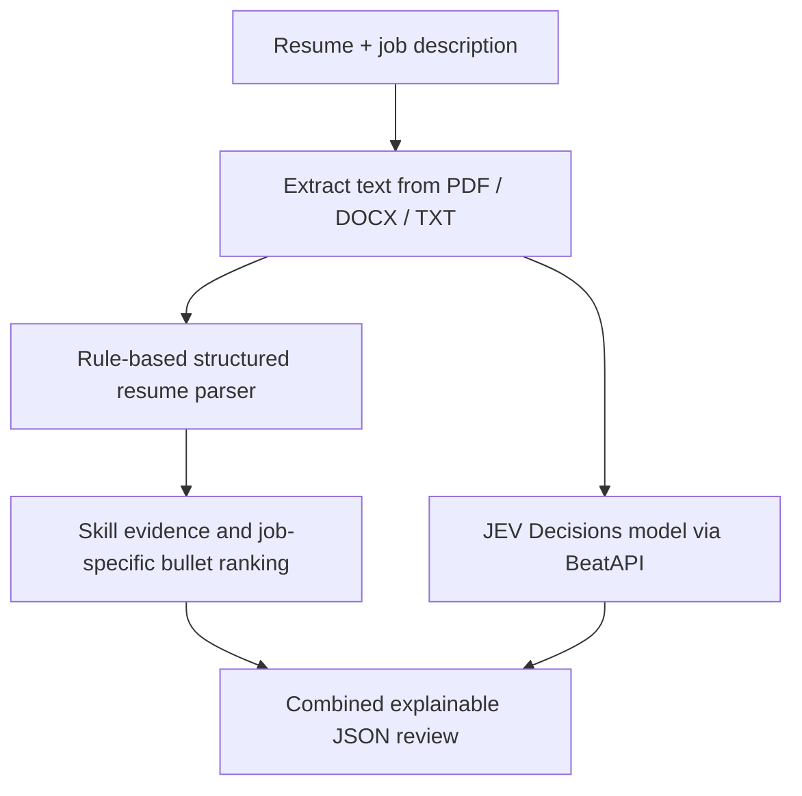

# JEV Resume Lab

**A FastAPI demo for evidence-based resume evaluation with the JEV Decisions model.**

Upload a resume, provide a target role and job description, and get an explainable JSON review. The project demonstrates how to integrate **JEV through [BeatAPI](https://beatapi.io/)** with Python-based resume parsing, skill evidence checks, and job-specific bullet ranking.

> **Demo / learning project:** Scores summarize claims found in a resume. They are not verified measures of ability, hiring probabilities, or automatic hiring recommendations.

## What it does

- Accepts **PDF, DOCX, and TXT** resumes.
- Extracts **employment history, projects, responsibilities, achievements, and outcomes** into structured JSON.
- Compares required job skills with evidence in the resume, distinguishing **matched**, **partially demonstrated**, and **not demonstrated** requirements.
- Calls the **JEV Decisions API** to score resume relevance, impact, ownership, presentation, and related criteria.
- Returns separate **job-match** and **resume-quality** scores, plus evidence-backed bullet rankings.
- Includes Swagger UI and synthetic sample resumes for testing without a frontend.

## Tech stack

**Python · FastAPI · Pydantic · JEV (BeatAPI) · HTTPX · pypdf · python-docx · pytest**

## Getting started

**Prerequisites:** Python **3.9+** and a [BeatAPI](https://beatapi.io/) API key to run JEV evaluations. The free JEV model also requires an API key and is subject to provider limits.

### 1. Clone and install

```bash
git clone https://github.com/YOUR_USERNAME/jev-resume-lab.git
cd jev-resume-lab
python -m venv .venv
```

Activate your environment:

```bat
:: Windows CMD
.venv\Scripts\activate
```

```bash
# macOS / Linux
source .venv/bin/activate
```

Install dependencies:

```bash
python -m pip install -r requirements.txt
```

### 2. Configure JEV

Copy `.env.example` to `.env`:

```bat
:: Windows CMD
copy .env.example .env
```

```bash
# macOS / Linux
cp .env.example .env
```

Set these values in `.env`:

```dotenv
BEATAPI_API_KEY=your_beatapi_key_here
JEV_MODEL=jev-1.14-free
```

`APP_API_KEY` is optional for local testing. If set, requests to the API endpoints must include an `x-api-key` header. **Never commit your `.env` file or real candidate resumes.**

Without `BEATAPI_API_KEY`, the service uses a clearly labeled `local-heuristic` mode instead of JEV. To test actual **JEV usage**, configure the key and check the `model` field in the response.

### 3. Run the API

```bash
uvicorn app.main:app --reload
```

Open **http://127.0.0.1:8000/docs** to use Swagger UI.

## Try the demo

1. Open **`POST /api/parse`**, choose `fixtures/02_backend_python_developer.txt`, and execute. This displays extracted resume structure **without using JEV**.
2. Open **`POST /api/review`**, upload the same resume, set `target_role` to `Python Backend Engineer`, and paste the contents of `examples/python_backend_job.txt` into `job_description`.
3. Inspect the JSON output. With a valid BeatAPI key, the `model` field identifies the JEV model used for evaluation.

### Main endpoints

| Endpoint | Description |
| --- | --- |
| `GET /health` | Simple health check |
| `POST /api/parse` | Extract structured resume information; no JEV call |
| `POST /api/review` | Parse, match evidence, evaluate with JEV, and return scores |

`/api/review` accepts `multipart/form-data` with `file` (required), `target_role` (required), and `job_description` (optional). Both upload endpoints accept PDF, DOCX, or UTF-8 TXT files up to **5 MB**. PDF input is limited to **30 pages** and extracted text to **40,000 characters**.

**Selected review fields:**

```json
{
  "job_match_score": 0,
  "resume_quality_score": 0,
  "matching_skills": [],
  "partial_required_skills": [],
  "missing_required_skills": [],
  "skill_evidence": [],
  "criteria": {},
  "bullet_reviews": [],
  "structured_resume": {},
  "model": "jev-1.14-free"
}
```

*Illustrative field structure; actual scores and evidence depend on the uploaded resume, target role, and JEV response.*

## How it works



| File | Purpose |
| --- | --- |
| `app/main.py` | FastAPI routes, BeatAPI client, evaluation questions, skill matching, and score aggregation |
| `app/structured_parser.py` | Rule-based section, employment, project, and evidence extraction |
| `app/relevance.py` | Job-aware transferable capability signals for bullet ranking |
| `fixtures/` | Synthetic sample resumes for API testing |
| `tests/` | Unit and regression tests; BeatAPI interactions are mocked in local tests |

**JEV handles evaluation**, not PDF extraction or resume structure generation. The parser and skill-evidence checks run locally in Python; JEV returns numerical judgments for the evaluation criteria. The final scores and bullet rankings are assembled by the application.

## Tests

```bash
python -m pytest -q
```

## Optional: Docker

```bash
docker build -t jev-resume-lab .
docker run --rm -p 8000:8000 --env-file .env jev-resume-lab
```

## Limitations

This is a **JEV integration demo**, not a production applicant-screening service. Structured parsing uses rules and may struggle with scanned, multi-column, or unusually formatted documents; image-only PDFs require OCR outside this project. Skill matches reflect **resume claims**, not independently verified proficiency. Local automated tests mock BeatAPI, so a live API key and network connection are needed to test the real model. Review provider privacy terms before submitting real resumes.
